# LAB 04

## Mô tả
Xây dựng chương trình Console quản lý sản phẩm. Dữ liệu được lưu trong bộ nhớ thông qua Repository<T>.

## Chức năng
- Thêm sản phẩm.
- Xuất danh sách sản phẩm.
- Tìm sản phẩm theo mã.
- Tìm sản phẩm theo tên.
- Lọc sản phẩm theo khoảng giá.
- Xóa sản phẩm.
- Tính tổng giá trị kho.
- Thoát chương trình.

## Hình ảnh kết quả

### Thêm sản phẩm

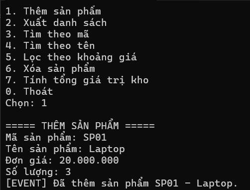

### Kiểm tra mã sản phẩm trùng

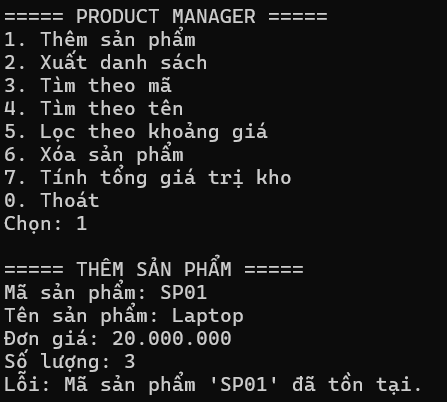

### Xuất danh sách sản phẩm

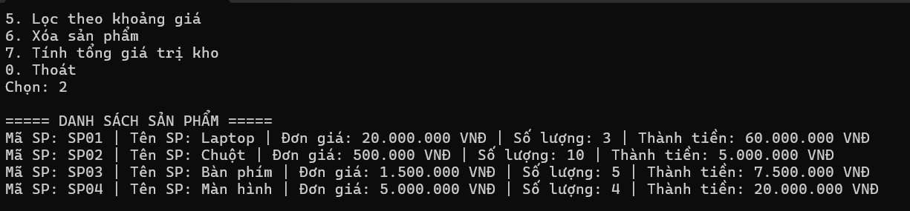

### Tìm sản phẩm theo mã — tìm thấy

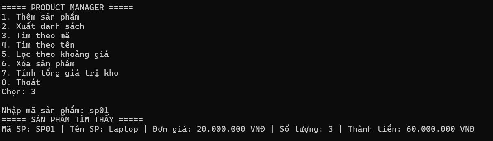

### Tìm sản phẩm theo mã — không tìm thấy

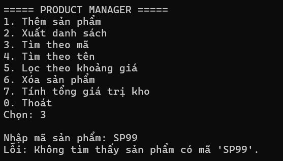

### Tìm sản phẩm theo tên — tìm thấy

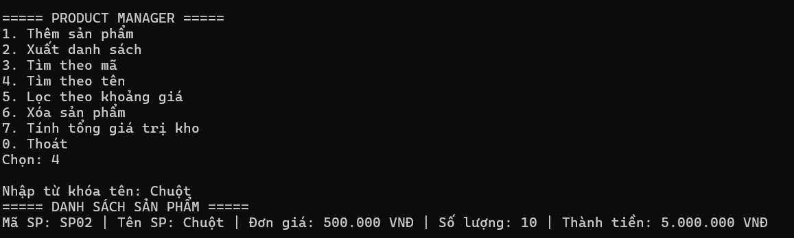

### Tìm sản phẩm theo tên — không tìm thấy

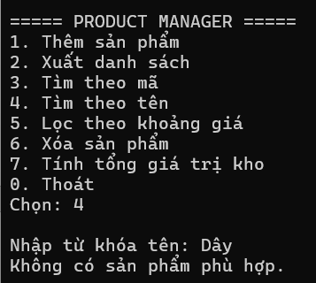

###  Lọc sản phẩm theo khoảng giá

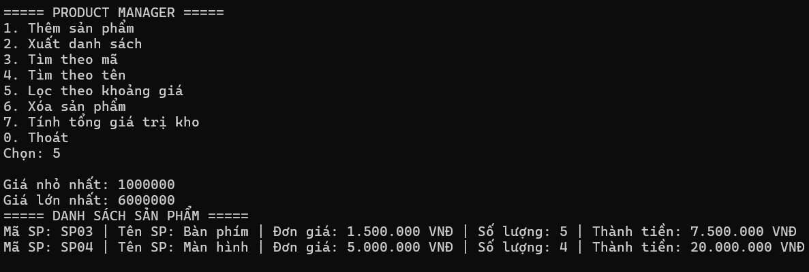

###  Xóa sản phẩm

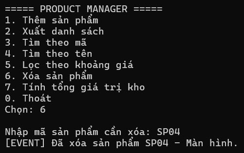

### Tính tổng giá trị kho

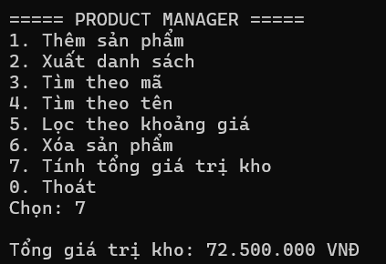

### Thoát chương trình

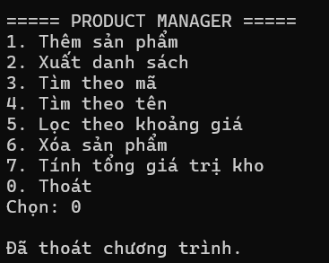
