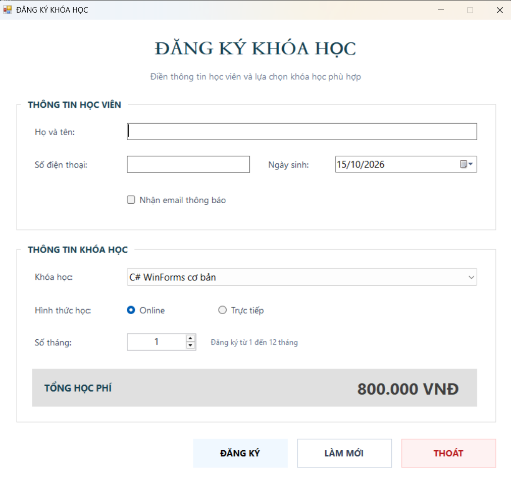
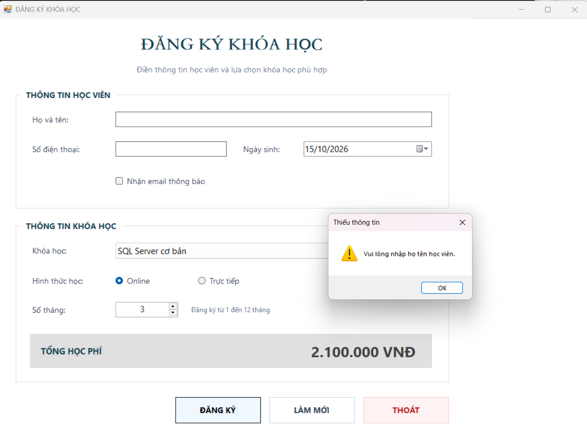
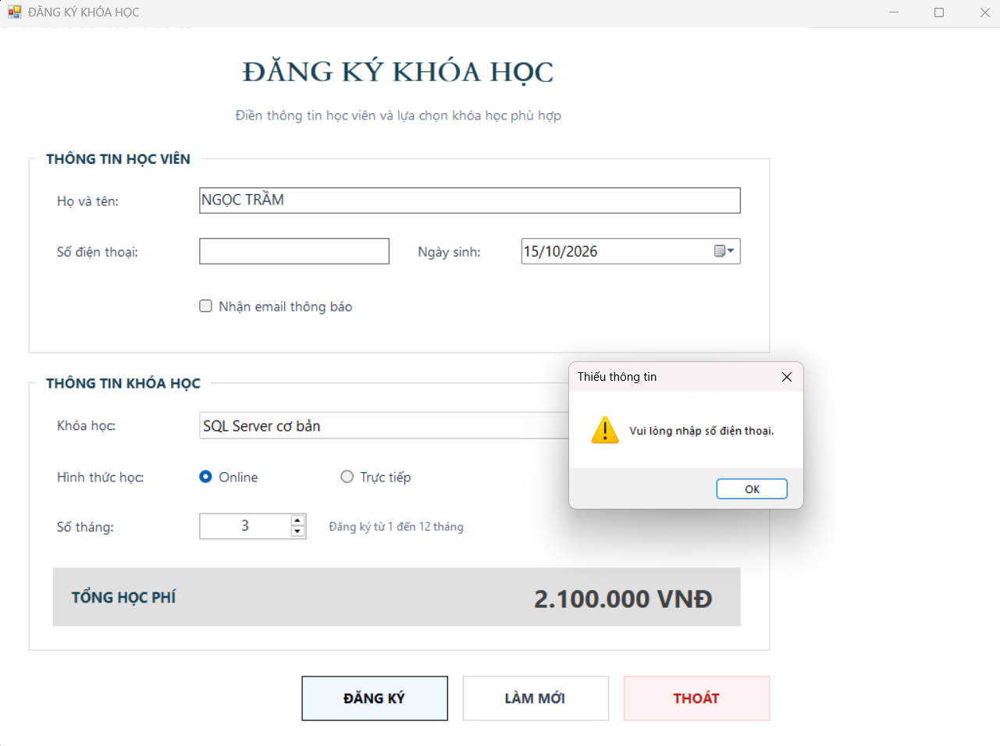
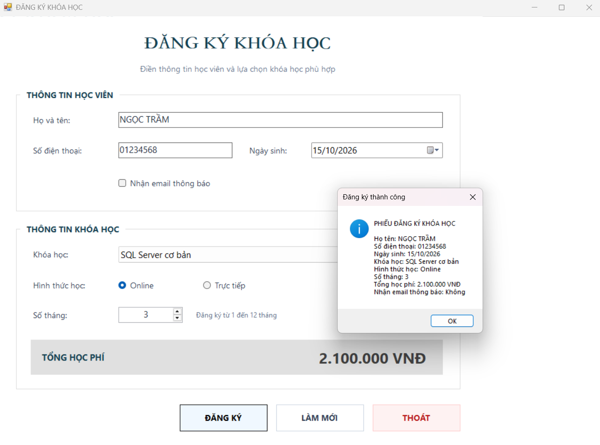
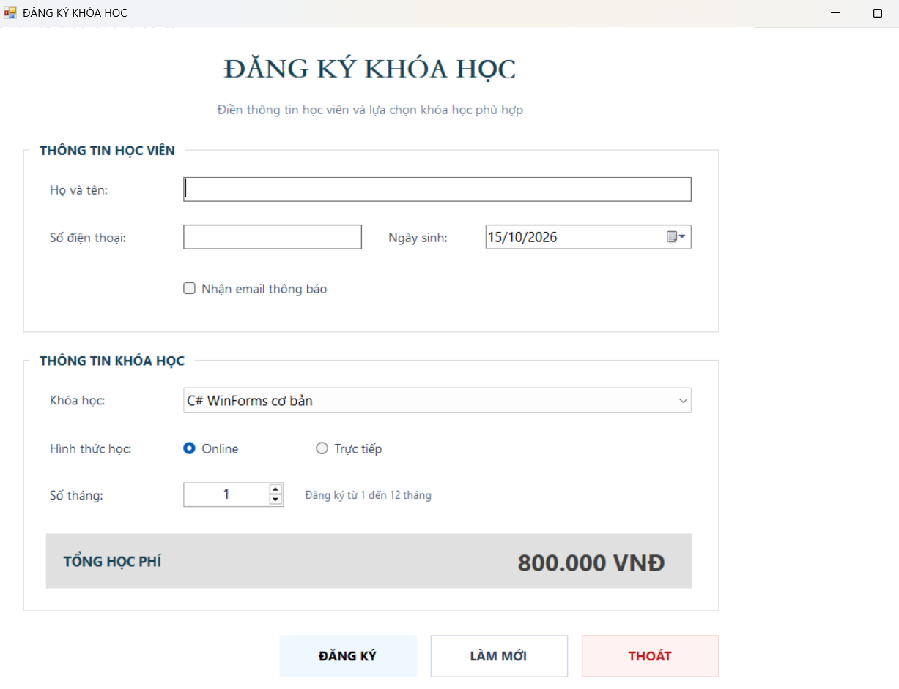
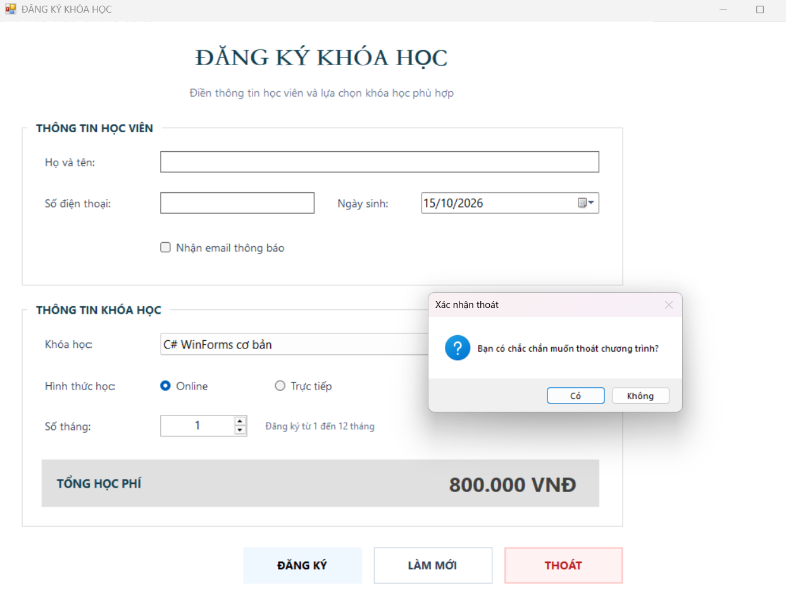

# Lab05 - Windows Forms cơ bản

## 1. Mô tả bài tập

Xây dựng ứng dụng đăng ký khóa học bằng C# Windows Forms.

Ứng dụng cho phép nhập thông tin học viên, lựa chọn khóa học,
hình thức học và số tháng đăng ký. Học phí được tự động cập nhật
khi thay đổi khóa học hoặc số tháng.

Chương trình xử lý dữ liệu trực tiếp trên Form, chưa sử dụng
cơ sở dữ liệu và chưa lưu thông tin đăng ký sau khi đóng ứng dụng.

## 2. Mục tiêu

- Tạo ứng dụng Windows Forms bằng ngôn ngữ C#.
- Thiết kế giao diện bằng Form Designer, Toolbox và Properties.
- Sử dụng các control cơ bản trong Windows Forms.
- Đặt tên control rõ ràng, đúng quy ước của đề bài.
- Xử lý các sự kiện Load, Click, SelectedIndexChanged và ValueChanged.
- Kiểm tra dữ liệu trước khi xử lý.
- Hiển thị thông tin đăng ký và hộp thoại xác nhận bằng MessageBox.

## 3. Giao diện 

### 3.1. Giao diện bắt đầu

### 3.2 Tính tổng học phí

### 3.3. Kiểm tra họ tên

### 3.4. Kiểm tra số điện thoại

### 3.5. Đăng ký thành công

### 3.6. Làm mới dữ liệu

### 3.7. Xác nhận thoát

