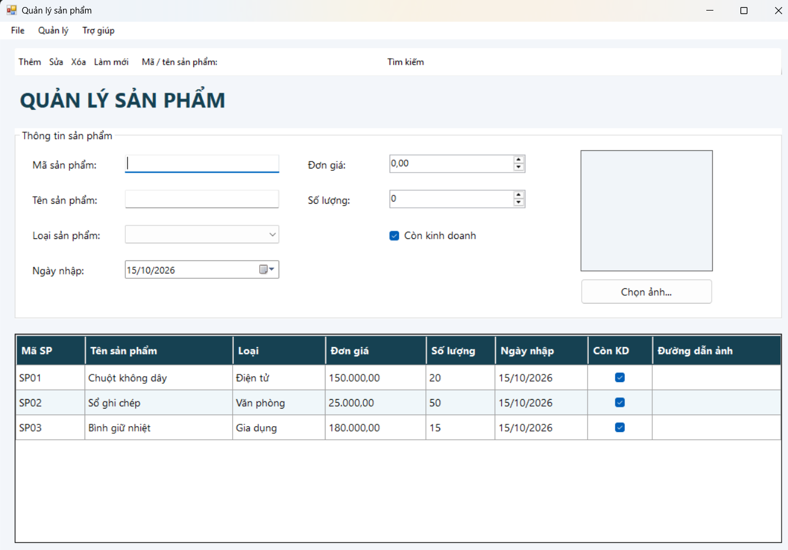
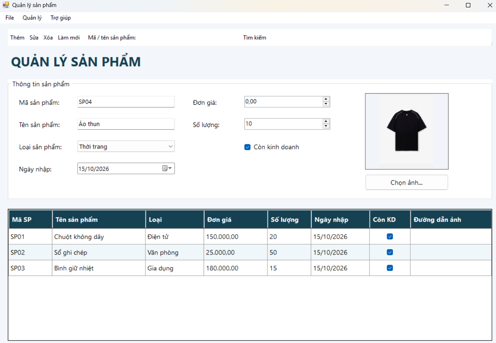
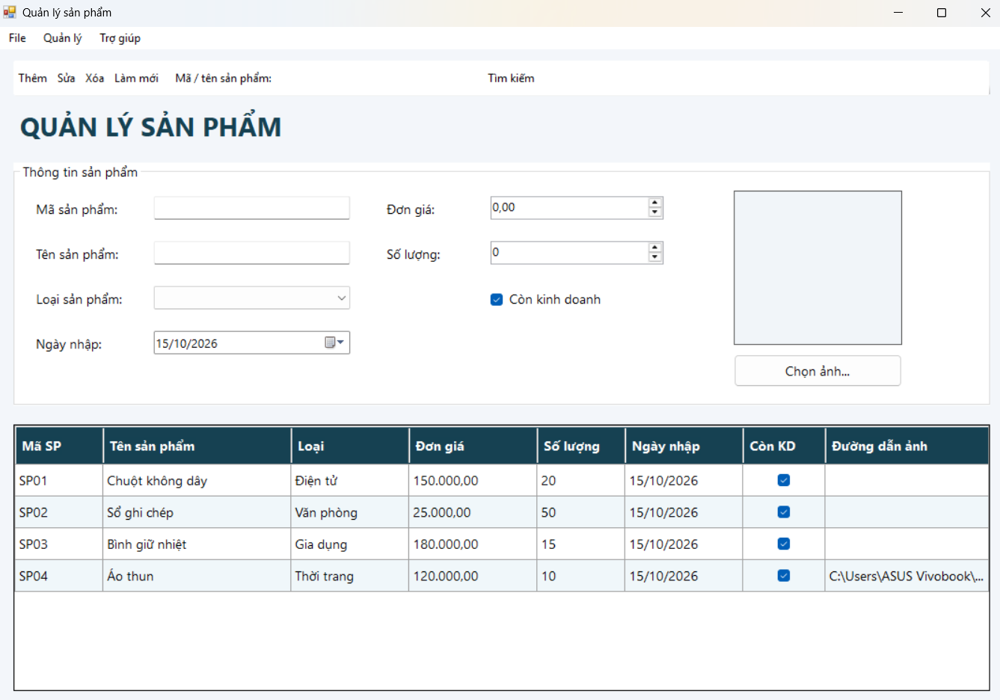
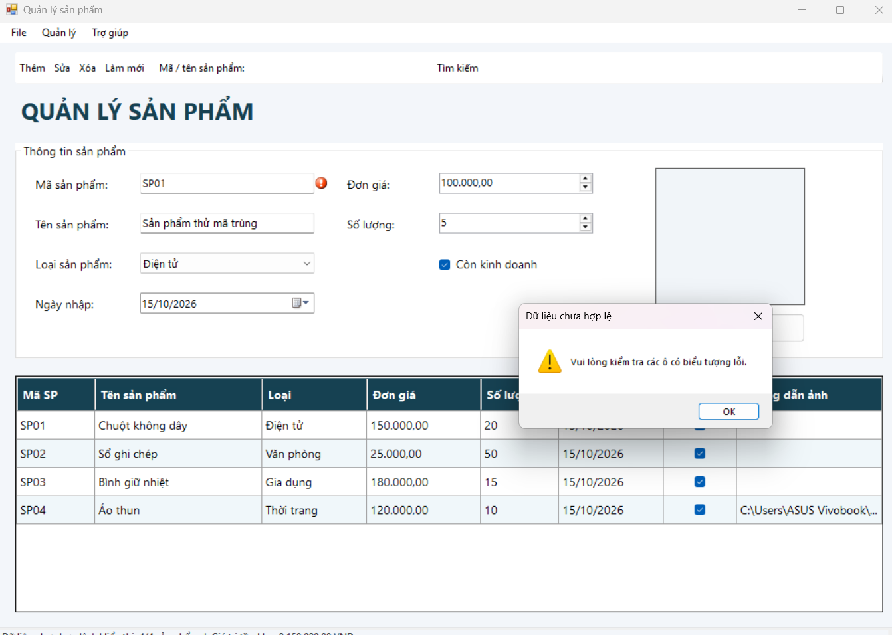
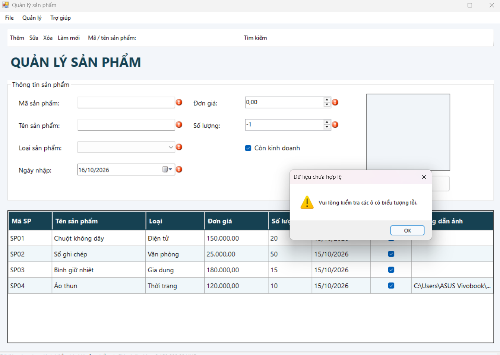
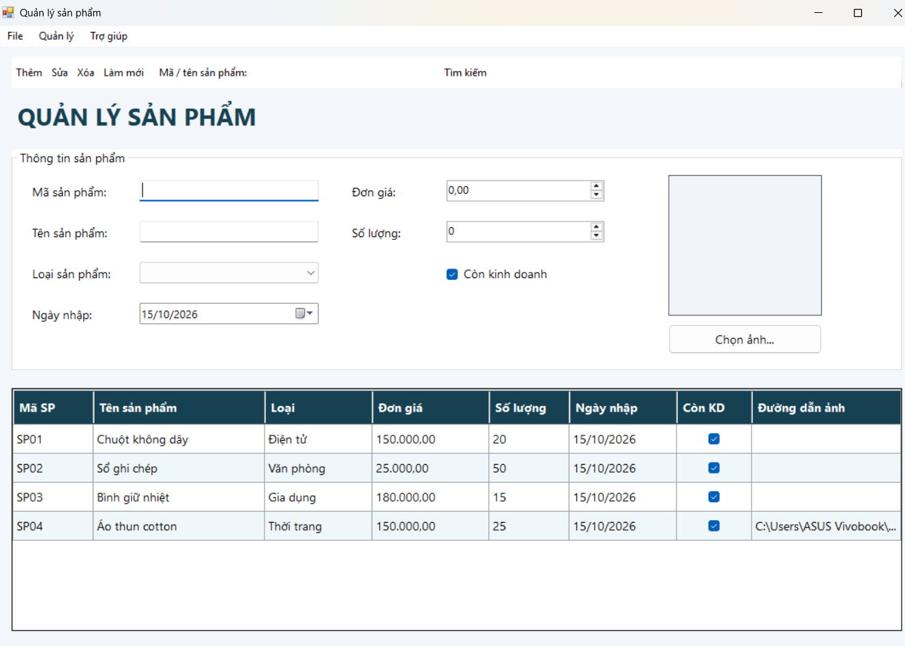
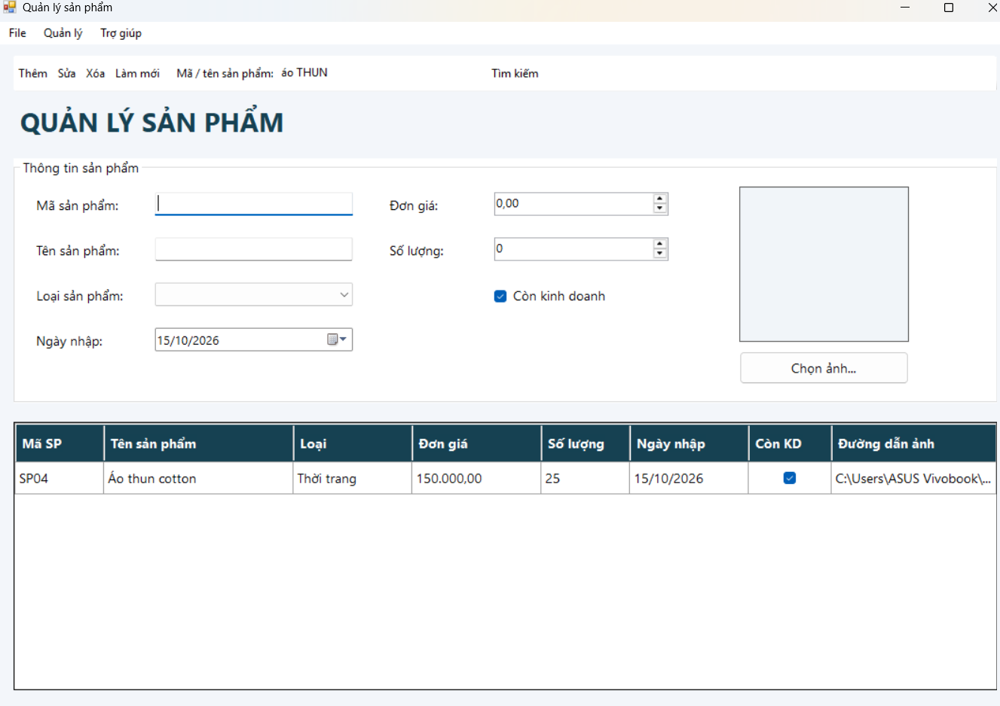
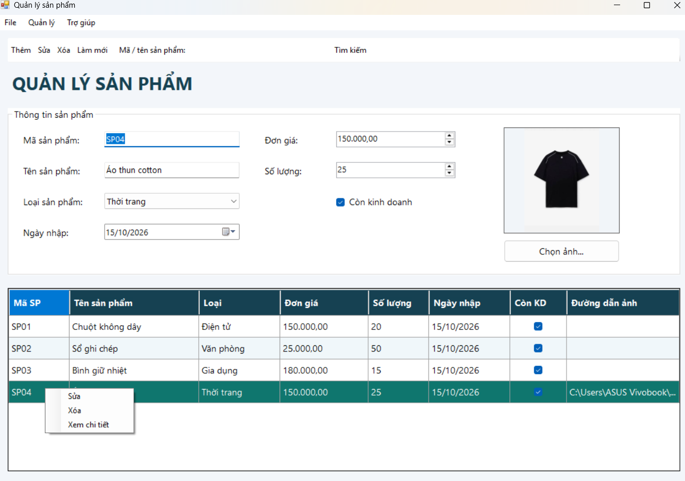
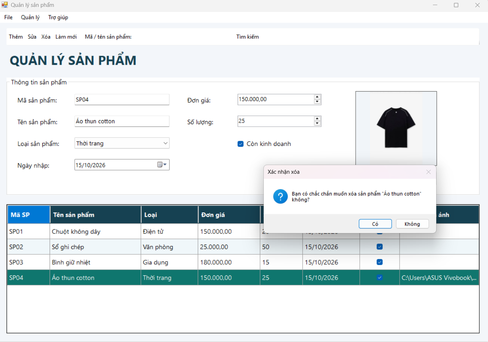
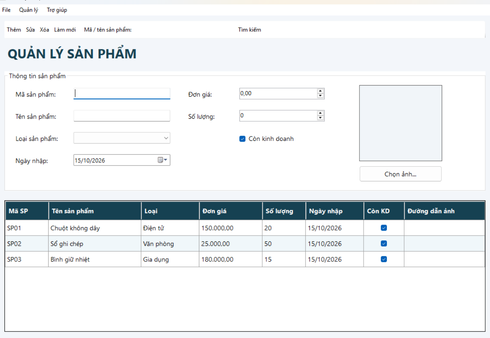

# Buổi 6 - Lab 05: Windows Forms nâng cao và DataGridView

## 1. Mô tả bài tập

Xây dựng ứng dụng Windows Forms quản lý danh sách sản phẩm
của một cửa hàng.

Ứng dụng cho phép thêm, sửa, xóa, tìm kiếm sản phẩm, chọn ảnh
và kiểm tra dữ liệu nhập.

Dữ liệu được lưu trong bộ nhớ bằng BindingList<Product>,
hiển thị trên DataGridView thông qua BindingSource.
Chương trình chưa kết nối cơ sở dữ liệu.

## 2. Các chức năng
- Nạp dữ liệu khi mở Form
- Thêm sản phẩm
- Sửa sản phẩm
- Xóa sản phẩm
- Tìm kiếm
- Làm mới

## 3. Kết quả thực hiện

### 3.1. Giao diện ban đầu

Giao diện hiển thị các thành phần quản lý và 3 sản phẩm mẫu.

### 3.2. Chọn ảnh sản phẩm

Chọn ảnh từ máy tính và hiển thị trong PictureBox.

### 3.3. Thêm sản phẩm

Thêm sản phẩm SP03 vào danh sách và cập nhật số lượng sản phẩm.

### 3.4. Kiểm tra mã trùng

Nhập mã đã tồn tại. Chương trình báo lỗi và không thêm sản phẩm.

### 3.5. Kiểm tra dữ liệu sai

Chương trình hiển thị ErrorProvider tại các trường không hợp lệ.

### 3.6. Sửa sản phẩm

Chọn sản phẩm trong bảng, thay đổi thông tin và cập nhật.

### 3.7. Tìm kiếm sản phẩm

Tìm theo mã hoặc tên, không phân biệt chữ hoa và chữ thường.

### 3.8. Menu chuột phải

Nhấp phải dòng để mở menu Sửa, Xóa và Xem chi tiết.

### 3.9. Xác nhận xóa

Hiển thị hộp thoại xác nhận trước khi xóa sản phẩm.

### 3.10. Làm mới

Xóa nội dung nhập, lỗi và bộ lọc; hiển thị lại toàn bộ danh sách.

