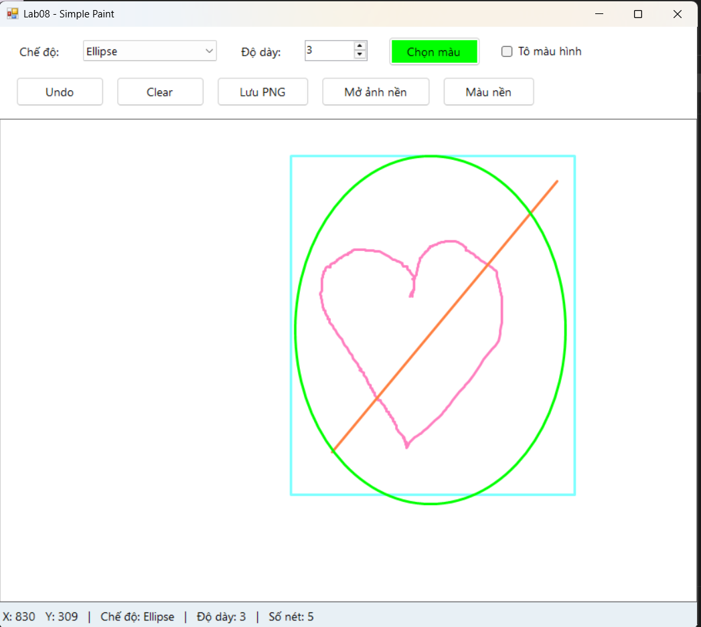
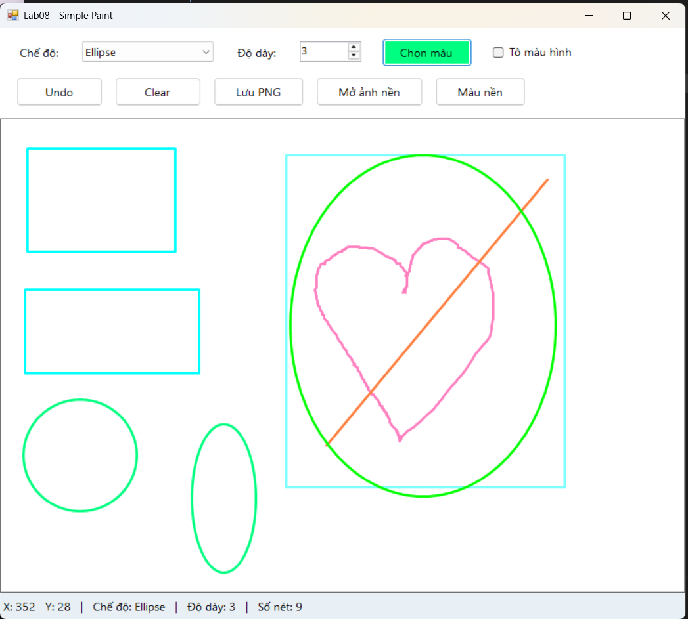
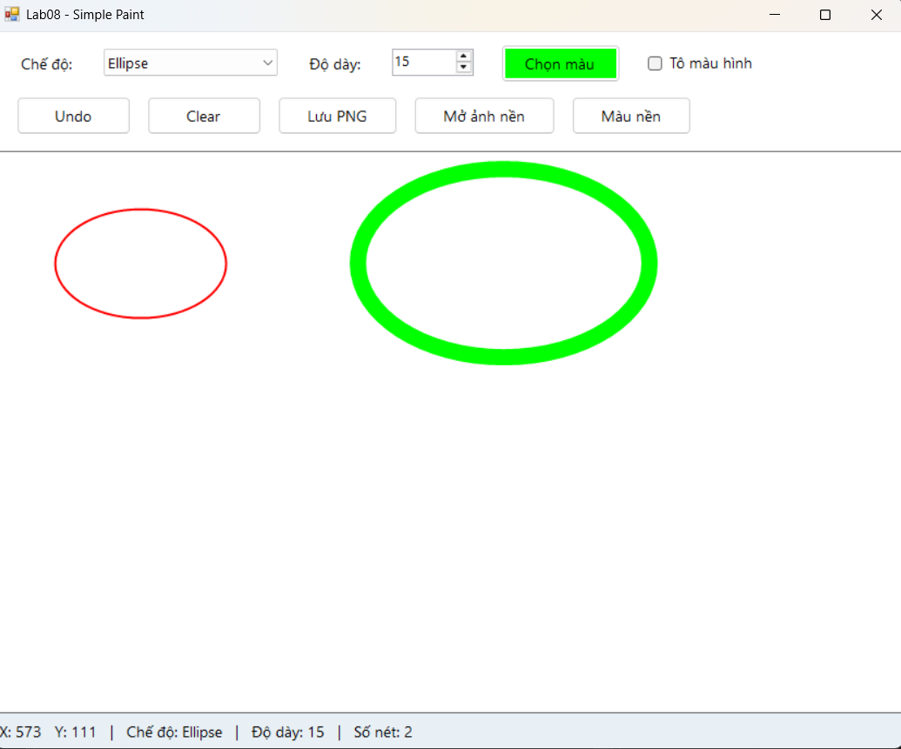
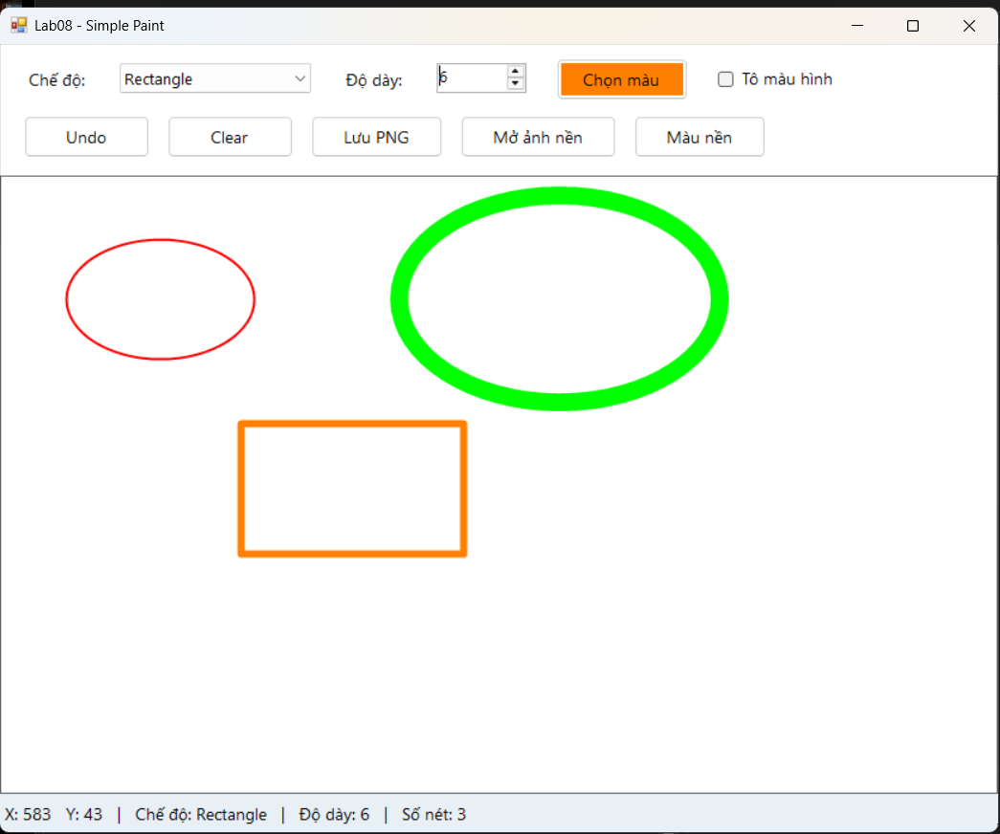
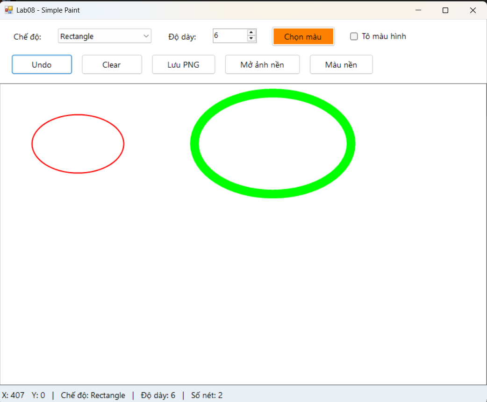
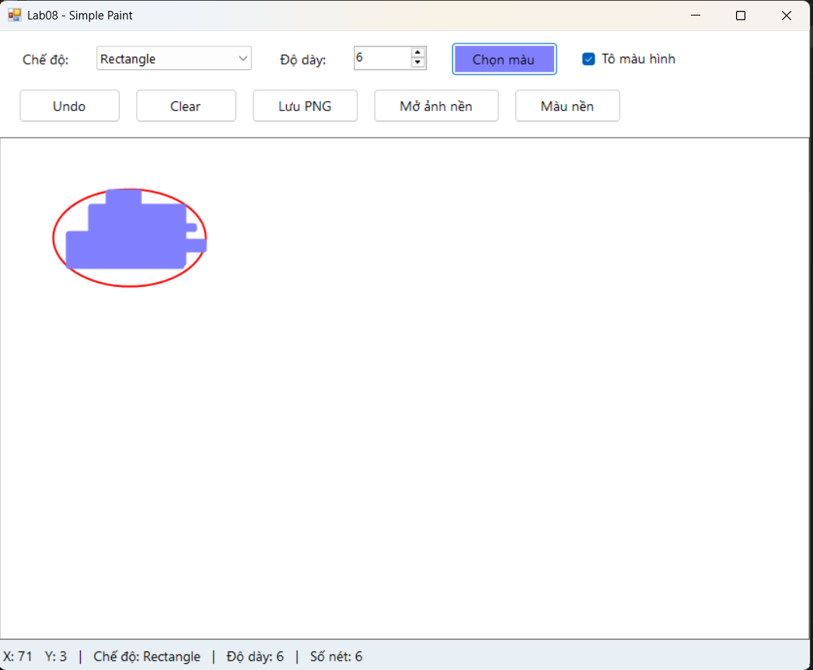
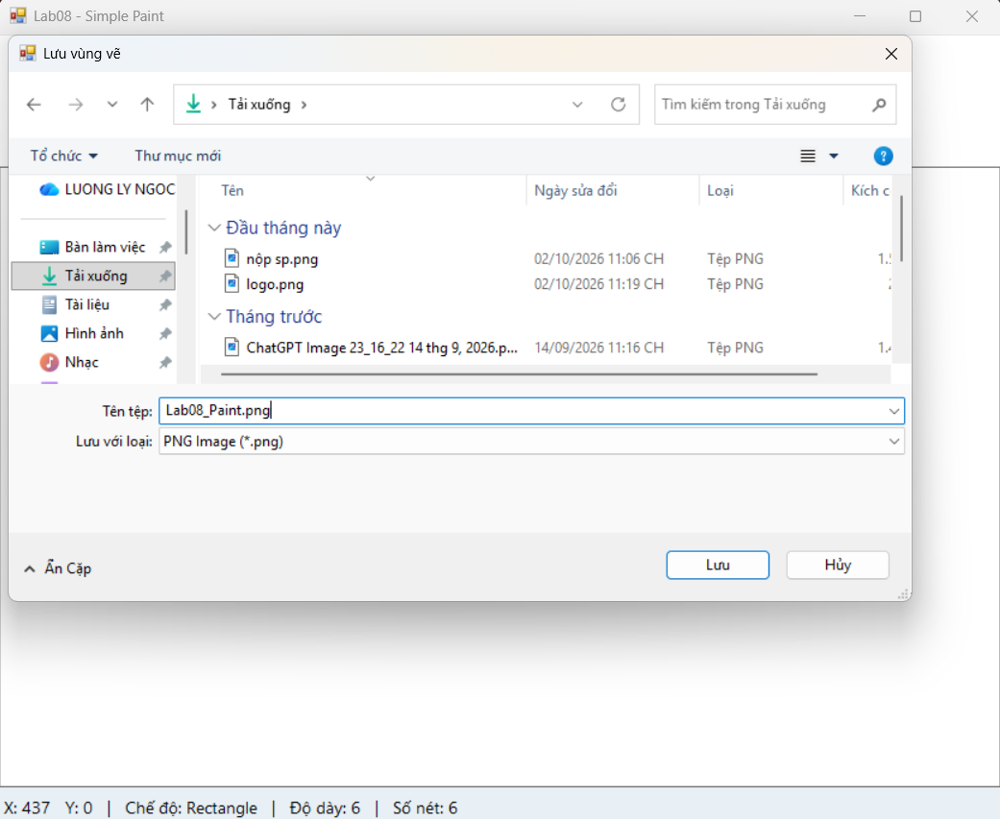
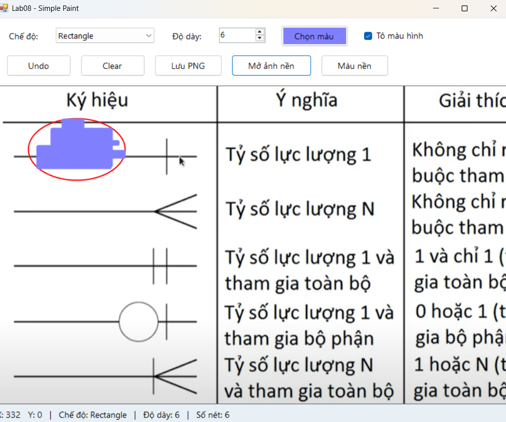
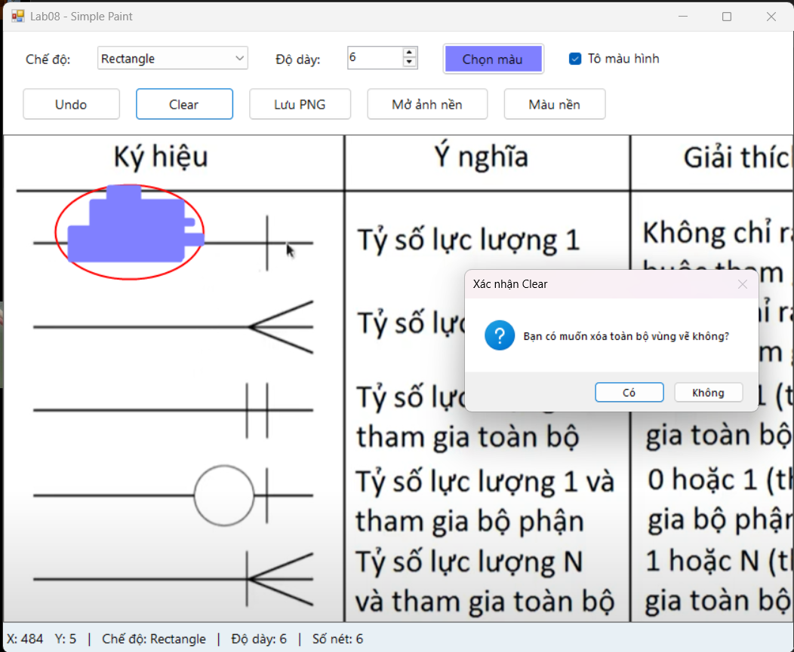
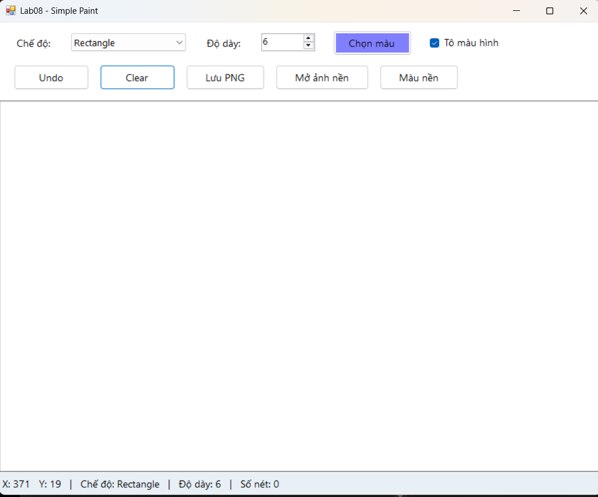

# Lab08 - Ứng dụng Simple Paint bằng WinForms và GDI+

## 1. Mô tả bài tập

Xây dựng ứng dụng Paint đơn giản bằng C# Windows Forms và GDI+,
cho phép người dùng vẽ trực tiếp bằng chuột trên vùng canvas.

Người dùng có thể chọn chế độ vẽ, màu sắc và độ dày nét vẽ.
Ứng dụng hỗ trợ vẽ tự do, đường thẳng, hình chữ nhật và hình ellipse.

Các nét vẽ được lưu trong danh sách List<DrawItem> và được vẽ lại
trong sự kiện Paint của canvas. Khi dữ liệu thay đổi, chương trình
gọi canvas.Invalidate() để cập nhật giao diện.

Nhờ lưu dữ liệu nét vẽ, các hình không bị mất khi thay đổi kích thước
cửa sổ hoặc khi cửa sổ bị che rồi hiển thị lại.

## 2. Các chức năng
- Vẽ bằng 4 nét: Pen, Line, Rectangle, Ellipse
- Chọn màu, độ dày (từ 1 đến 20)
- Undo ( xóa nét vẽ hoàn thành gần nhất)
- Clear (Xóa)
- Lưu vùng canvas hiện tại thành file PNG.
- Mở ảnh nền và vẽ thêm lên ảnh.
- Sử dụng Ctrl + Z để Undo.
- Tô màu bên trong hình chữ nhật và ellipse.
- Thay đổi màu nền canvas.
- Nhấn Esc để hủy nét đang kéo.

## 3. Giao diện ứng dụng

### 3.1. Vẽ bốn loại hình

### 3.2. Vẽ hình theo nhiều hướng

### 3.3. Chọn màu và độ dày

### 3.4. Chức năng Undo

Trước khi Undo:

Sau khi Undo, nét vẽ cuối cùng được xóa:

### 3.5. Tô màu hình

### 3.6. Kết quả lưu PNG

### 3.7. Vẽ trên ảnh nền 

### 3.8. Chức năng Clear

Hộp thoại xác nhận trước khi xóa:

Sau khi xác nhận, vùng vẽ được đưa về nền trắng:

