# Lab09 - Thiết kế và in thẻ sinh viên bằng WinForms

## 1. Mô tả bài tập

Xây dựng ứng dụng Windows Forms cho phép nhập thông tin sinh viên,
chọn ảnh đại diện, hiển thị bản xem trước và in thẻ sinh viên.

Thông tin được nhập trực tiếp trên Form, không sử dụng cơ sở dữ liệu.

Ứng dụng sử dụng PictureBox để hiển thị ảnh, GDI+ để vẽ thẻ,
PrintDocument để định nghĩa nội dung in, PrintPreviewDialog để
xem trước và PrintDialog để lựa chọn máy in.

## 2. Các chức năng

- Nhập thông tin Sinh Viên 
- Chọn ảnh đại diện 
- Xem trước thẻ trên Form
- Kiểm tra dữ liệu 
- Xem trước in và in thẻ
- Làm mới
- Chức năng mở rộng

## 3. Giao diện ứng dụng

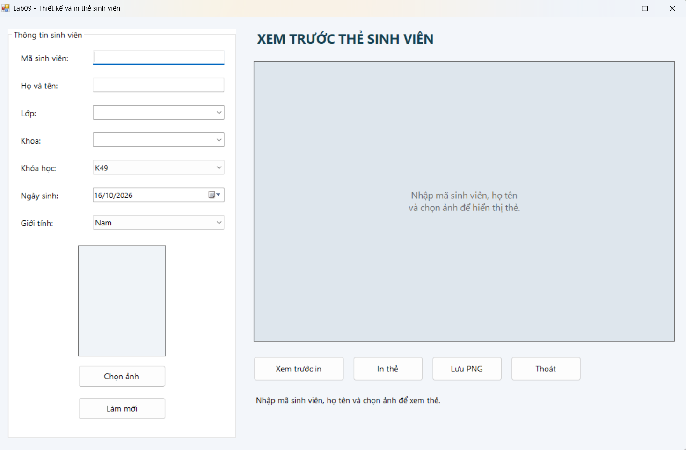

### 3.1. Kiểm tra thiếu mã sinh viên

### 3.2. Kiểm tra thiếu họ tên

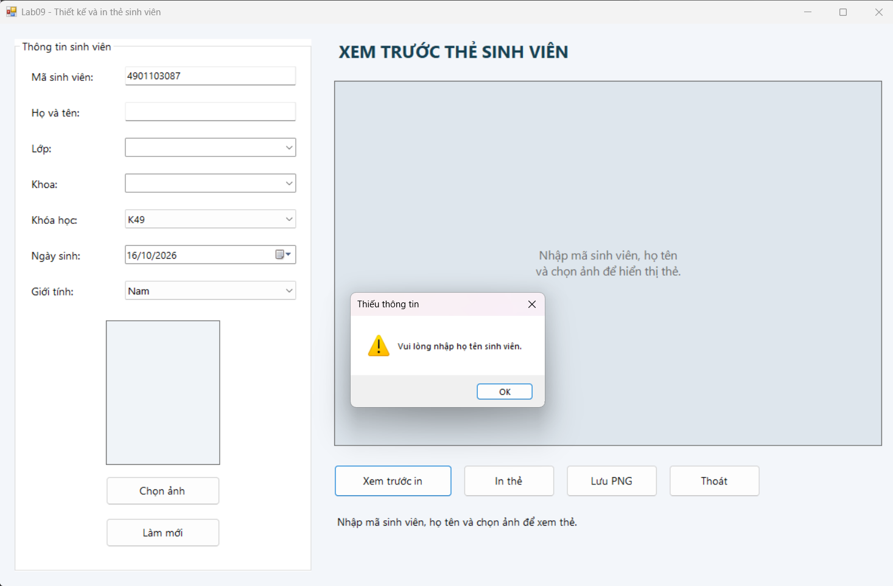

### 3.3. Kiểm tra thiếu ảnh

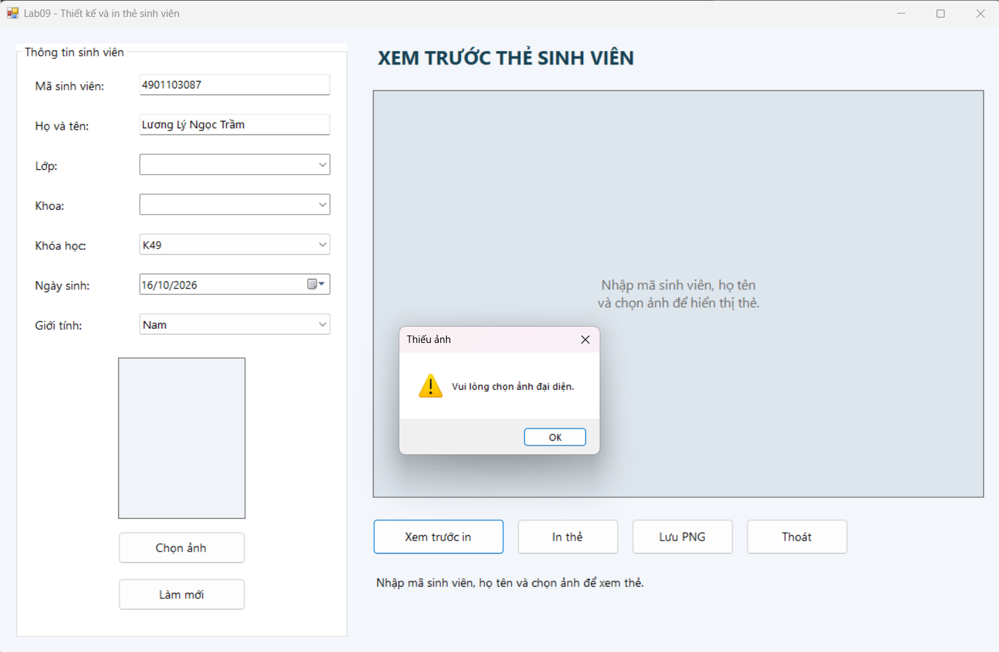

### 3.4. Xem trước thẻ trên Form

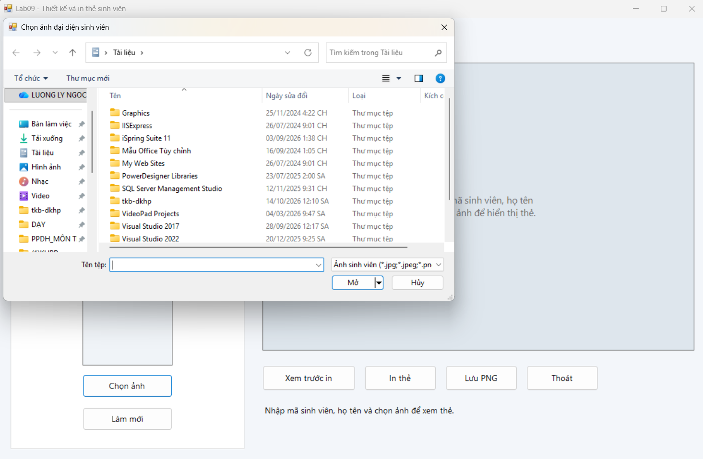

### 3.5. Cập nhật thông tin

Thẻ tự cập nhật khi người dùng thay đổi nội dung nhập.

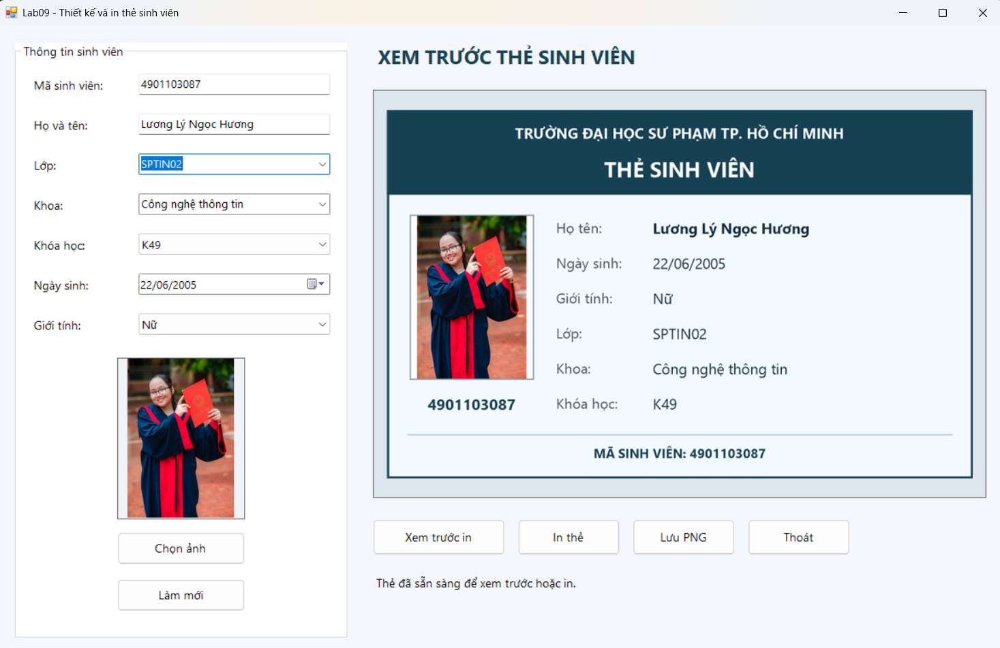

### 3.6. Thay đổi ảnh đại diện

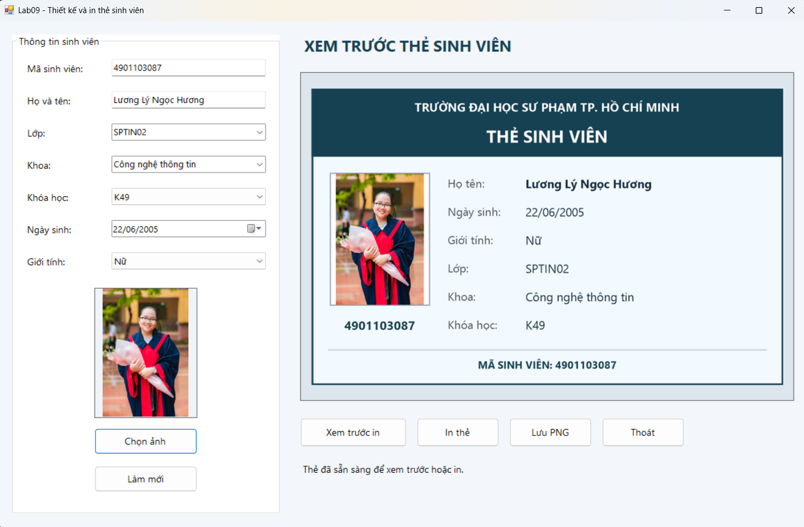

### 3.7. Giữ đúng tỉ lệ ảnh

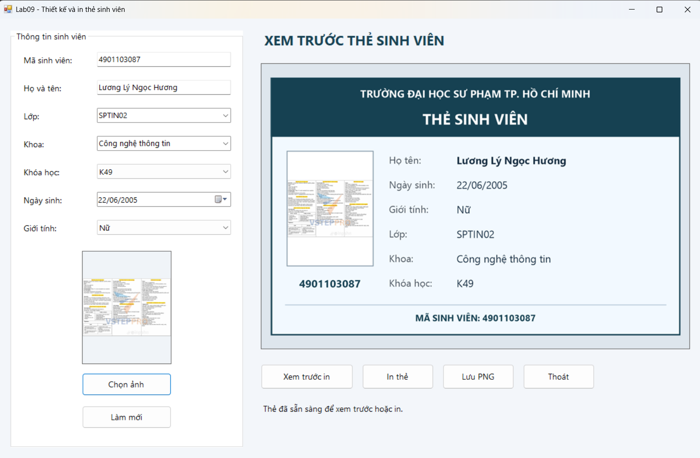

### 3.8. Xem trước in

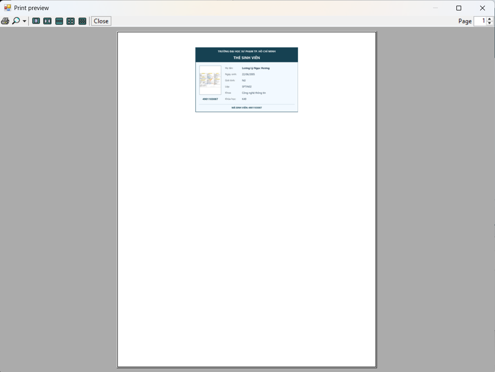

### 3.9. Hộp thoại chọn máy in

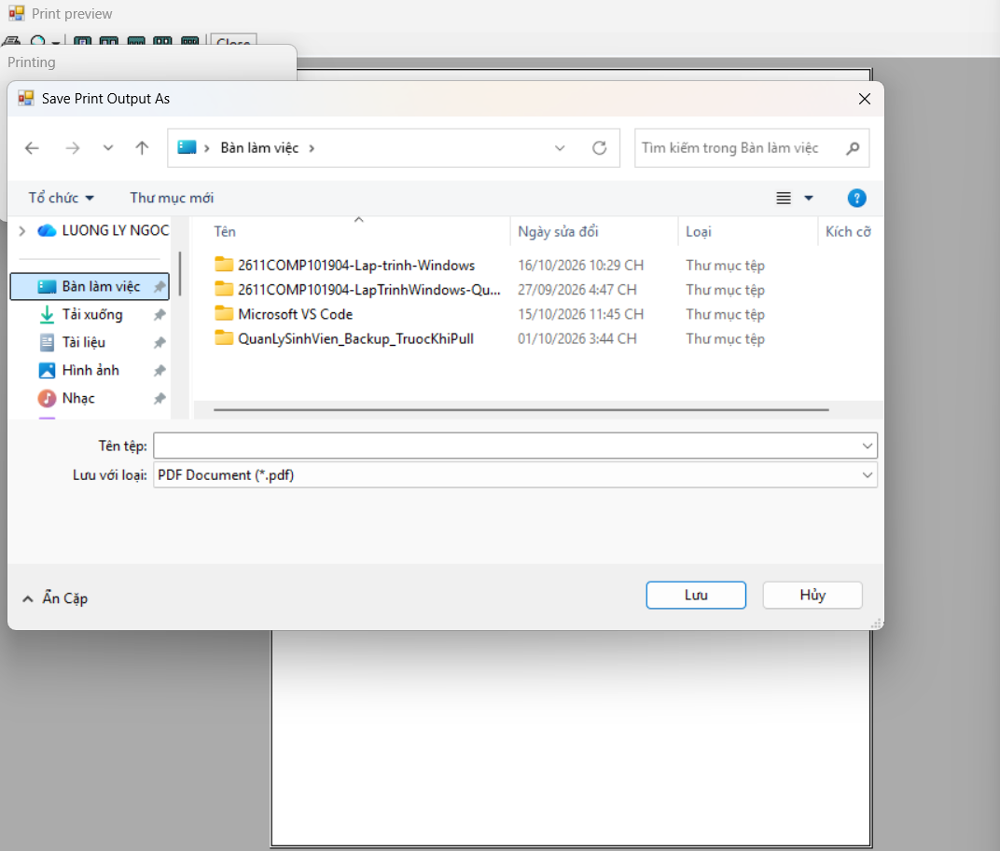

### 3.10. Làm mới dữ liệu

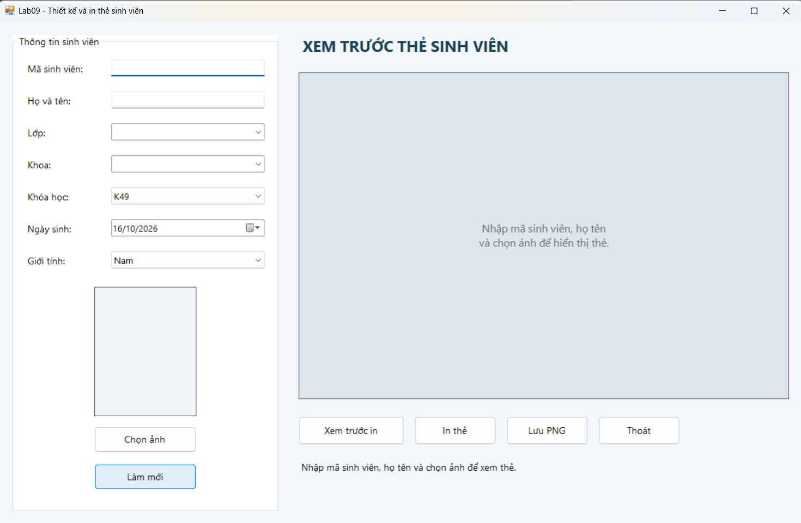

### 3.11. Thẻ xuất ra PNG

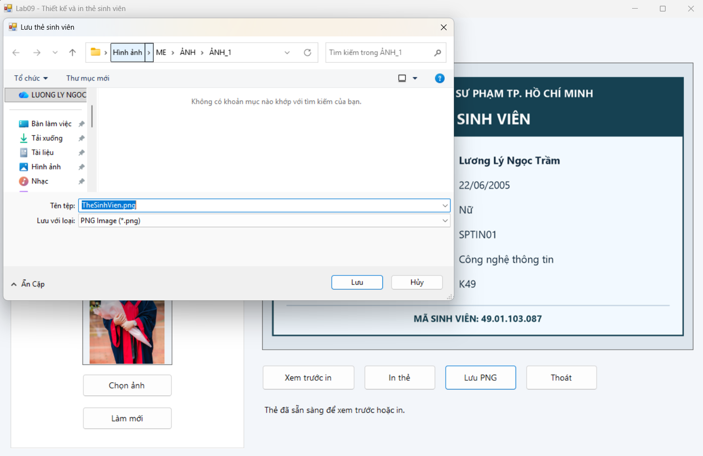

