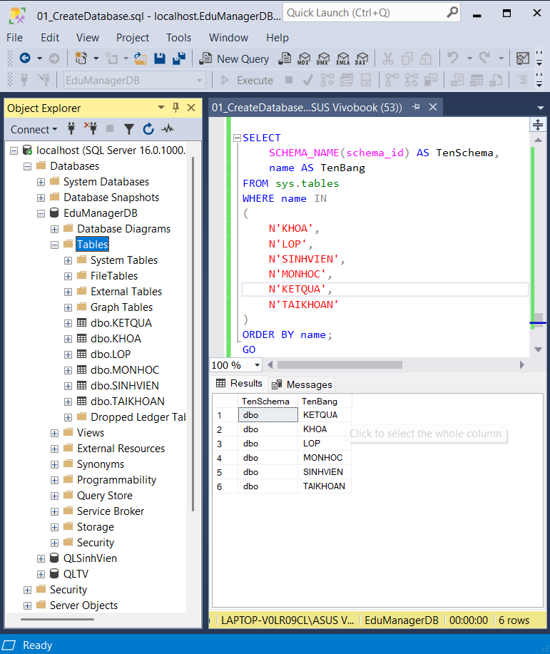
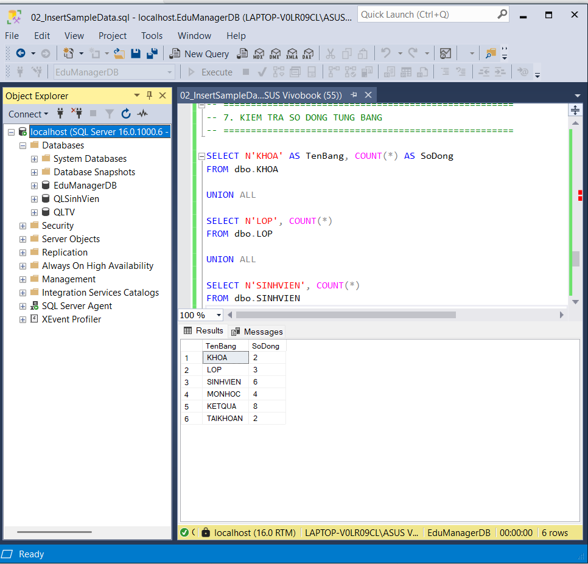
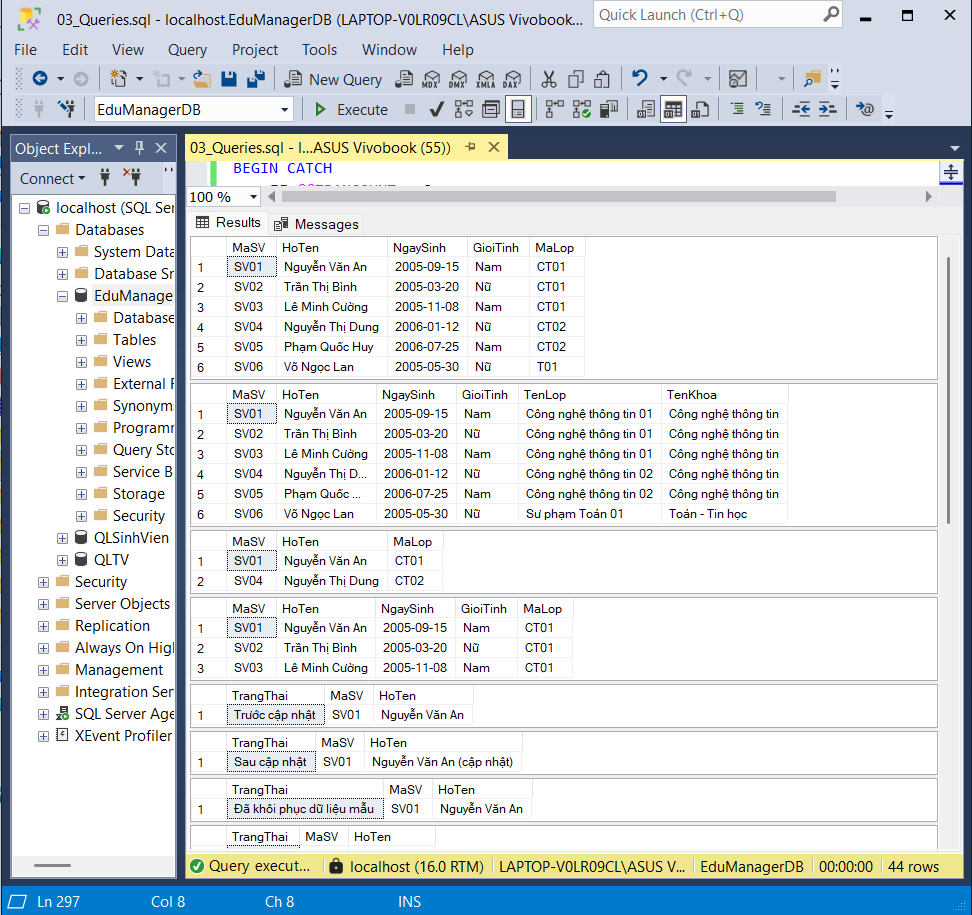
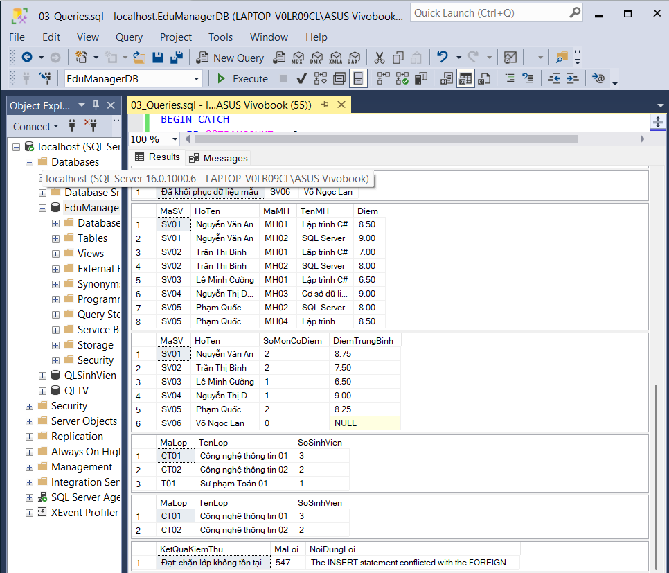
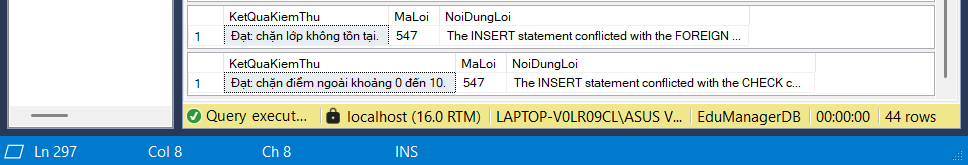

# Lab10 - Thiết kế cơ sở dữ liệu EduManagerDB bằng SQL Server

## 1. Mô tả bài tập

Thiết kế và cài đặt cơ sở dữ liệu EduManagerDB bằng SQL Server
phục vụ bài toán quản lý sinh viên.

Cơ sở dữ liệu quản lý thông tin khoa, lớp, sinh viên, môn học,
kết quả học tập và tài khoản đăng nhập demo.

Bài thực hành gồm tạo database, tạo bảng, thiết lập khóa chính,
khóa ngoại, ràng buộc dữ liệu, nhập dữ liệu mẫu và thực hiện
các truy vấn T-SQL.

## 2. Công cụ sử dụng

- Microsoft SQL Server.
- SQL Server Management Studio (SSMS).
- Ngôn ngữ T-SQL.
- Git và GitHub để quản lý, nộp bài.

## 3. Kết quả thực hiện

### 3.1. Tạo database và các bảng

### 3.2. Dữ liệu mẫu

### 3.3. Tạo danh sách SV

### 3.4. Tạo danh sách kết quả thao tác

### 3.5. Tạo danh sách kết quả lỗi khóa ngoại 
