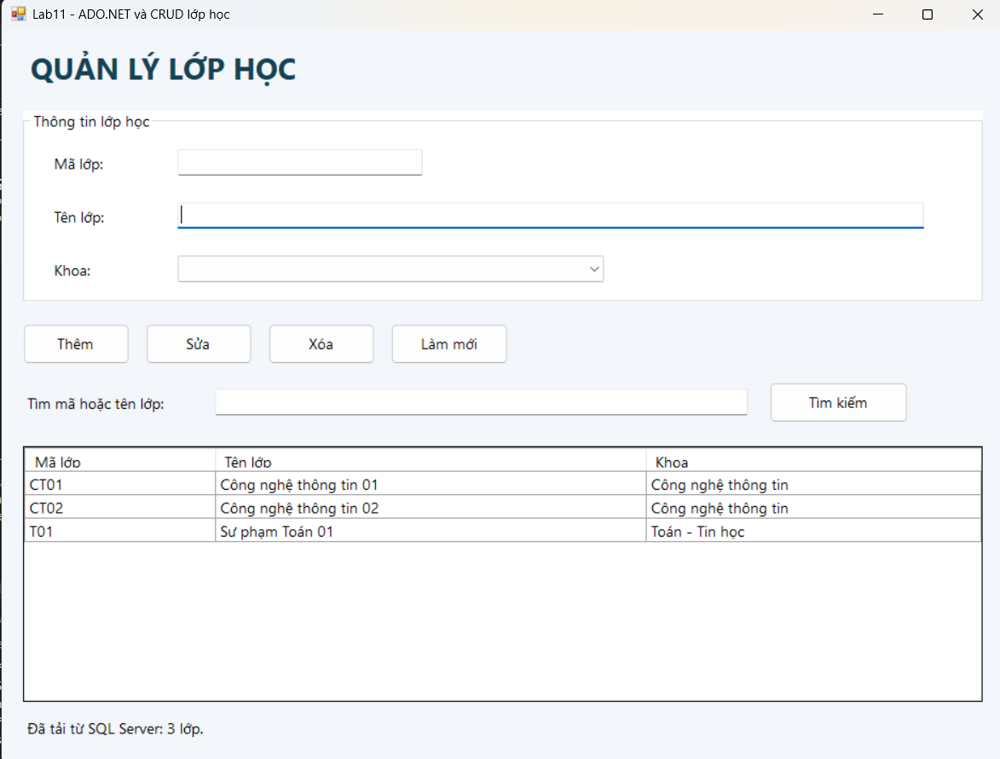
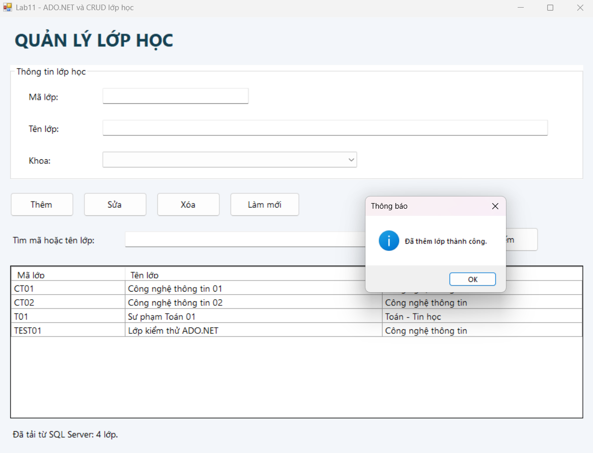
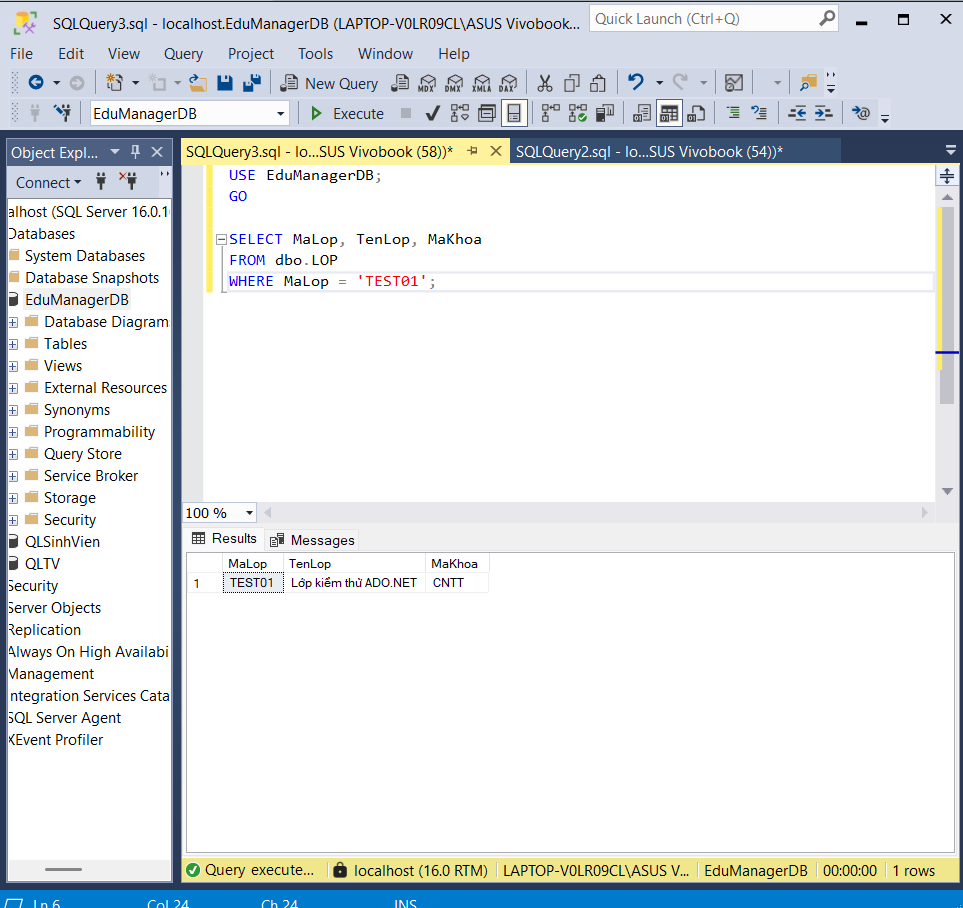
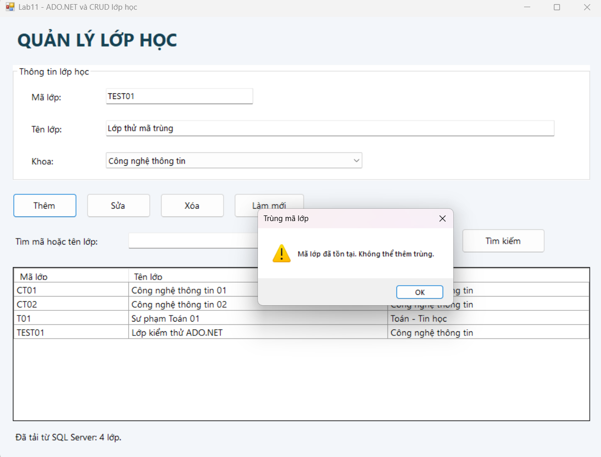
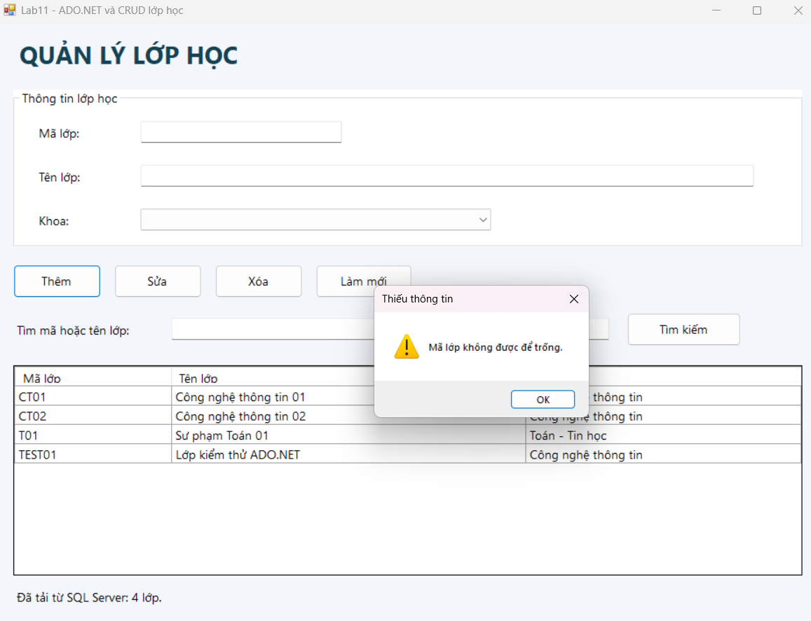
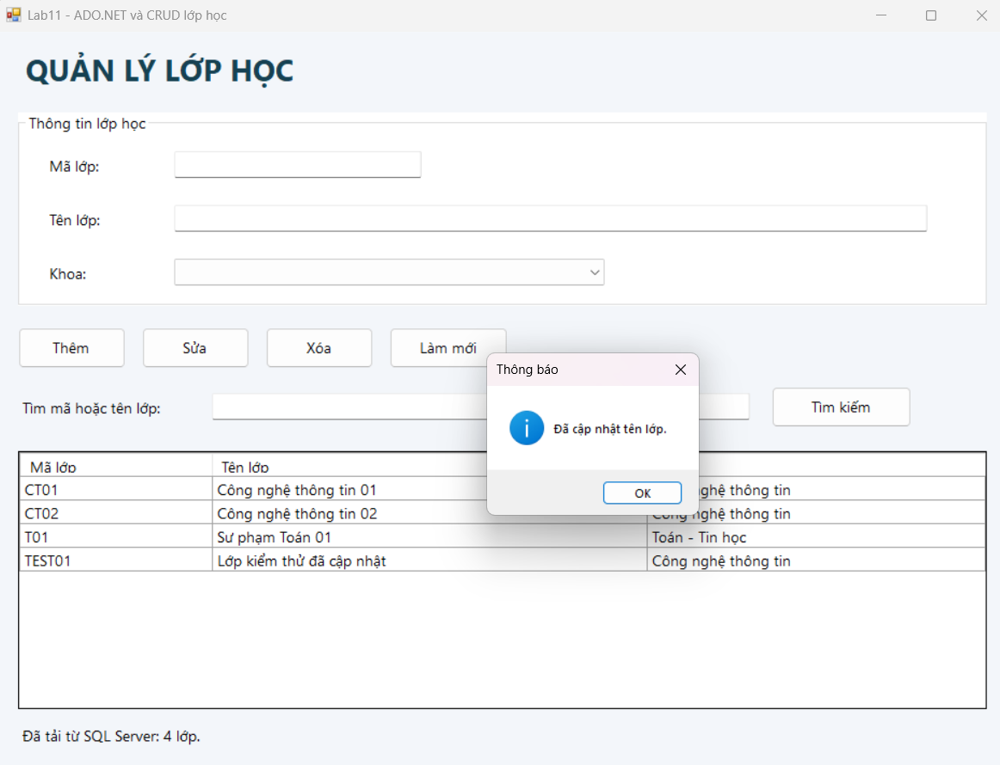
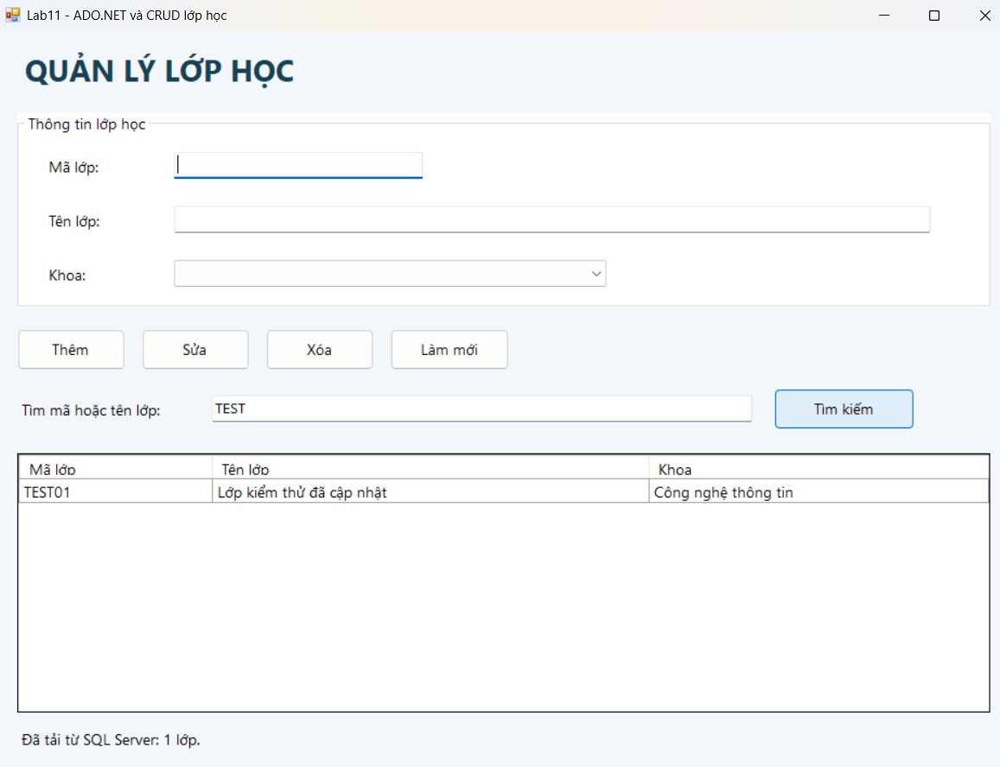
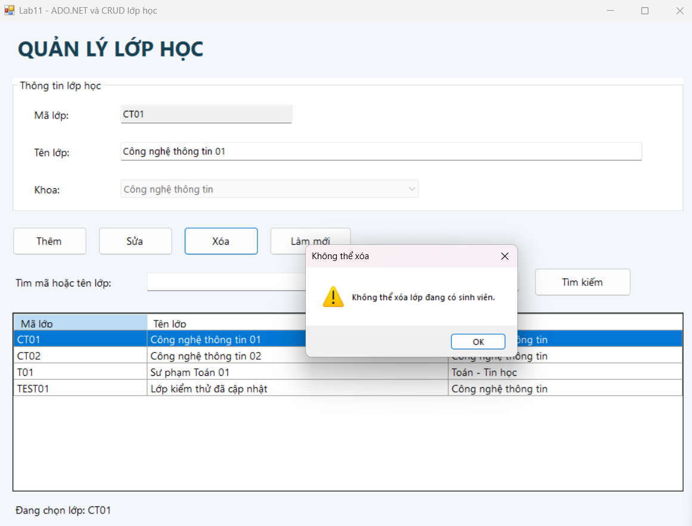
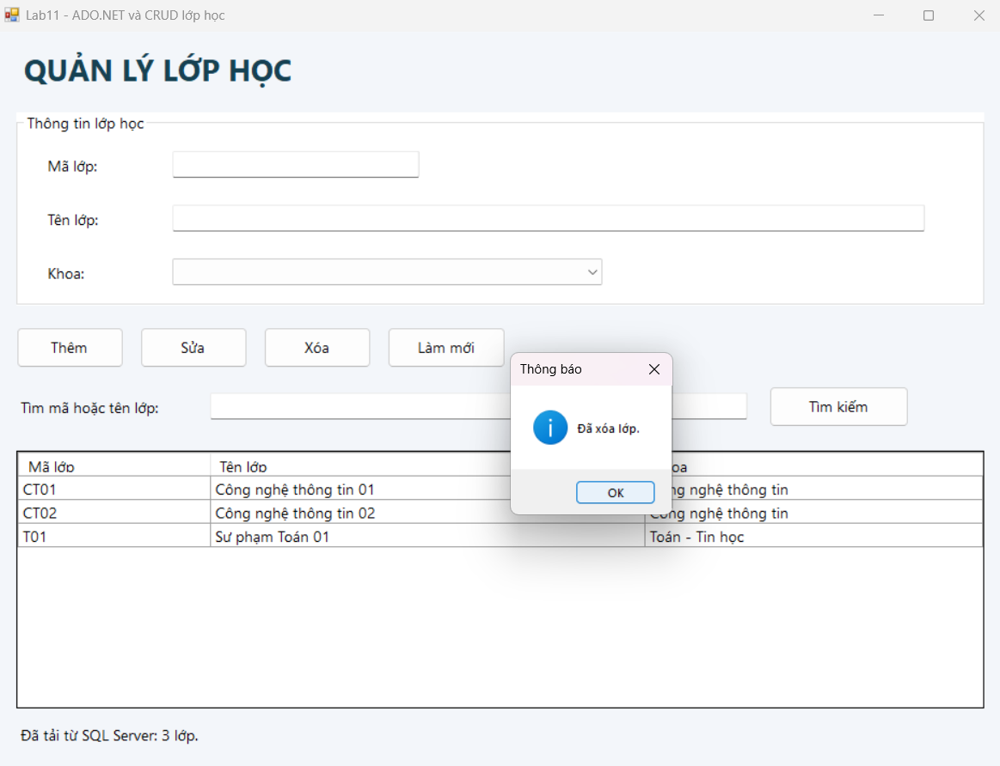

# Lab11 - ADO.NET và CRUD lớp học với SQL Server

## 1. Mô tả bài tập

Xây dựng ứng dụng C# Windows Forms quản lý lớp học, kết nối
cơ sở dữ liệu EduManagerDB trong SQL Server bằng ADO.NET.

Ứng dụng hiển thị danh sách lớp trên DataGridView, cho phép
thêm lớp, sửa tên lớp, xóa lớp, tìm kiếm và tải lại dữ liệu.

Dữ liệu được lưu trực tiếp trong SQL Server.
Các thao tác thêm, sửa và xóa vẫn được giữ sau khi đóng ứng dụng.

## 2. Các chức năng

- Tải danh sách lớp
- Chọn lớp 
- Thêm lớp 
- Sửa tên lớp 
- Xóa lớp
- Tìm kiếm 
- Làm mới 

## 3. Kết quả thực hiện

### 3.1. Kết nối và tải dữ liệu

### 3.2. Thêm lớp

### 3.3. Kiểm tra dữ liệu trong SQL Server

### 3.4. Kiểm tra mã lớp trùng

### 3.5. Kiểm tra dữ liệu trống

### 3.6. Sửa tên lớp

### 3.7. Tìm kiếm lớp

### 3.8. Chặn xóa lớp đang có sinh viên

### 3.9. Xác nhận xóa

